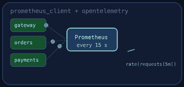
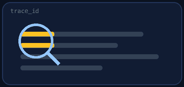
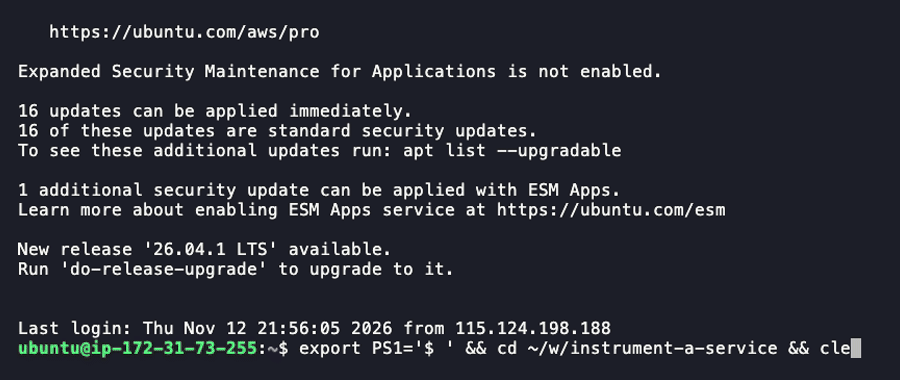

<p align="center"></p>

| | |
|-|-|
| **Time** | 105-120 min |
| **Cost** | free on your own machine |
| **You need** | Docker with Compose v2, curl, Python 3 and a terminal (on Windows use WSL) |

## How this lab works

1. **Fork** this repository to your own GitHub account (button at the top right).
2. Clone **your fork** in your Ubuntu environment (WSL on Windows, your OrbStack machine on Mac).
3. Read the lab below (the same text is in [`LAB.md`](LAB.md)) and follow the mission.
4. Answer the questions in [`SUBMISSION.md`](SUBMISSION.md). Where a question asks for output, paste it in a code block. No screenshots needed.
5. Commit and push. Open the **Actions** tab of your fork (click *I understand my workflows, go ahead and enable them* the first time). The **Lab check** shows what is still missing.
6. When the check is green, **submit the URL of your fork** in the course platform.

> [!NOTE]
> The check only looks at your answers and any files the lab asks you to commit. Your instructor reads your work and may ask you to explain any line.

<p align="center"></p>

## 🎬 The situation

<p align="center"></p>

```text
GO-LIVE REVIEW - loyalty-points service                     go-live: Monday
Function      : awards points to customers, +10% bonus on big purchases
Code review   : passed
Tests         : green
Logs          : none
Metrics       : none
Traces        : none
Decision      : NOT READY TO RUN IN PRODUCTION
```

Everything you observed over the last days was *built to be observed*: Beanie writes JSON logs with a request id, exposes `/metrics` and emits a trace for every order. Somebody wrote that code, and the day nobody did, the first production incident was a guessing game. If the loyalty service gets slow on Tuesday, or answers 404 to customers who should exist, nothing will say *why*, *since when* or *for whom*.

You will open the gate without changing a single thing the service does: three signals, three small pieces of code, each with a trap that real teams fall into.

> [!IMPORTANT]
> **Your mission**
> - Add **structured JSON logs** with a request id and a trace id, one access line per request
> - Add **Prometheus metrics**: a request counter, a latency histogram, an in-flight gauge and a business counter, with labels that cannot explode
> - Add **OpenTelemetry traces**, including your own span around the slow step
> - Check all three in Prometheus, Jaeger and the container logs, then let the checker do it
> - Tear down and prove it

**Time:** 105-120 min | **Cost:** free | **You need:** Docker with Compose v2, curl, Python 3 and a terminal. On Windows use WSL.

<p align="center"></p>

## Part 0 - The silent service

Fork this repository, clone your fork and run:

```bash
./setup.sh
curl -s -X POST localhost:8080/points/ana -H 'Content-Type: application/json' -d '{"points": 120}'
curl -s localhost:8080/points/ana
docker compose logs loyalty
```

`setup.sh` builds the service (`service/app.py` is the only file you edit) and starts it with a **Prometheus** (http://localhost:9096) that scrapes it and a **Jaeger** (http://localhost:16686) that receives its traces. The service answers. The logs contain nothing about your requests. Read `service/app.py`: it is 50 lines. The three TODO blocks at the bottom are the specification. Run `./setup.sh` again after each change to rebuild.

> [!NOTE]
> **Think** Before you write anything: for each of these three questions, which signal would you reach for first? *"Is the loyalty service up and answering?"*, *"Why was this one customer's request slow at 14:32?"*, *"How many points do we award per hour?"* Keep your answers for question 6 of your submission.

<p align="center"></p>

## Part 1 - Logs

<p align="center"></p>

Use the `logging` module (not `print`) and a formatter that writes **one JSON object per line** to stdout: `ts`, `level`, `service`, `msg`, `request_id` and `trace_id`. Add a middleware that writes **one access line per request** with `method`, `route`, `status` and `duration_ms`.

Two details matter more than the format:

- **The request id.** Take it from the incoming `X-Request-ID` header or generate one, put it in every log line of that request (a `contextvars.ContextVar` carries it across the code without passing it around), and return it in the `X-Request-ID` response header. Now a customer who says "my order failed" can give you the id from their screen.
- **What you must not log.** Never the `Authorization` header or a request body. The checker sends a request with a secret token and then searches your logs for it.

Add a business line `points added` at `info` level with the **customer id** but **not** the total.

```bash
docker compose logs loyalty | tail -5
```

<p align="center"></p>

## Part 2 - Metrics

Use `prometheus_client` and expose `GET /metrics` (`generate_latest()`). Define:

| Metric | Type | Labels |
|--------|------|--------|
| `loyalty_http_requests_total` | Counter | `method`, `route`, `status` |
| `loyalty_http_request_duration_seconds` | Histogram | `method`, `route` |
| `loyalty_http_requests_in_flight` | Gauge | none |
| `loyalty_points_awarded_total` | Counter | none (points including the bonus) |

The trap is the `route` label. `request.url.path` is `/points/ana`, `/points/bruno`, `/points/chloe`... one new time series for every customer, forever. After a year you have a million series and a Prometheus that falls over. Use the **route template** (`request.scope["route"].path`, which is `/points/{customer}`). The rule of thumb: *a label's values must come from a short list that you could write down*.

For the histogram choose buckets around what matters. This service answers in about 5 milliseconds, except for purchases that call `compute_bonus`, which takes 50 ms. Buckets of 1 to 10 seconds would tell you nothing.

Count `/healthz` and `/readyz`, but not `/metrics` itself. Check in Prometheus (Status > Targets, then graph `rate(loyalty_http_requests_total[1m])`).

> [!NOTE]
> **Predict** If you used the real path as the `route` label and 1,000 different customers called the service, how many series would `loyalty_http_requests_total` have? And what if you added the `request_id` as a label?

<p align="center"></p>

## Part 3 - Traces

If `OTEL_EXPORTER_OTLP_ENDPOINT` is set (it is, in the provided `compose.yaml`), configure a `TracerProvider` with a resource `service.name`, a `BatchSpanProcessor` and the OTLP/HTTP exporter, and instrument FastAPI so that every request becomes a server span. Exclude `healthz`, `readyz` and `metrics`: a trace for every health check is noise that costs money.

Then add **your own span** around the call to `compute_bonus()`, named `compute_bonus`, with the attribute `points`. The framework span tells you that the request took 60 ms. Yours tells you that 50 of them were spent in the rules engine.

Finally connect the signals: the access log line already has a `trace_id` field. Fill it from the current span (`trace.get_current_span().get_span_context()`, formatted as 32 hex characters). Now you can take a `trace_id` from a log line, paste it into Jaeger, and see the whole request.

> [!NOTE]
> **Think** The OpenTelemetry middleware must wrap yours, so that when your middleware runs there is already an active span. In what order did you register them, and why does the order matter in a "last added is outermost" system?

<p align="center"></p>

## Part 4 - Look at it

```bash
for i in 1 2 3; do curl -s -X POST localhost:8080/points/ana -H 'Content-Type: application/json' -d '{"points": 150}' >/dev/null; done
curl -s localhost:8080/points/nobody
curl -s localhost:8080/metrics | grep loyalty_
docker compose logs loyalty | tail -4
```

Open Jaeger, choose the service `loyalty` and click one trace: you should see the server span with `compute_bonus` inside it. Then take the `trace_id` from a log line and open `http://localhost:16686/trace/<trace_id>`.

Write `OBSERVABILITY.md`: what each signal is for, in your own words, and one thing you chose **not** to record.

<p align="center"></p>

## Part 5 - Prove it

<p align="center"></p>

```bash
./verify.sh
```

It rebuilds your service, sends scripted traffic (including a request with a secret header and a chosen request id), and inspects the `/metrics` text, the real log lines, Prometheus and Jaeger. Fix what is red and run it again until it ends with **ALL CHECKS PASSED**.

> [!TIP]
> **Stuck?** `loyalty_http_requests_total` has a series per customer: you used the path, not the template; the template is only known **after** routing, so read `request.scope.get("route")` after `call_next`. The access line has no `trace_id`: your middleware runs outside the span; register the instrumentation after your middleware. Counts are doubled: you count in the middleware and in the endpoint. Jaeger shows no `loyalty` service: wait 10 seconds (spans are batched) and check that `OTEL_EXPORTER_OTLP_ENDPOINT` ends up without a trailing `/v1/traces` (the exporter needs the full URL `.../v1/traces` when you pass `endpoint=` yourself). `/healthz` shows up as spans: add it to `excluded_urls`.

<p align="center"></p>

## Level up (optional)

- Add `loyalty_points_awarded_total` per `tier` (`bronze`, `silver`, `gold`). Why is `tier` a good label and `customer` a bad one?
- Add an exemplar to the histogram that links a slow bucket to a `trace_id`. What does Grafana let you do with it?
- Write the alert "5xx ratio above 1% for 5 minutes" in PromQL against your metrics.
- Replace your hand-written middleware with the `opentelemetry-instrumentation-asgi` metrics. What do you get for free and what do you lose (naming, labels)?

<!-- teardown:start (generated by labs.py, do not edit) -->
## Tear down (mandatory)

<p align="center"></p>

Resources left behind cost money, keep doors open and pollute the next lab. Removing what you created is part of the job, so it is part of the submission: **you must prove it is gone**.

Do this **last**, after you have pasted your `verify` output into `SUBMISSION.md` (once you tear down, the lab can no longer be verified).

1. Run `./teardown.sh`. It removes the containers, network, volumes and image of the lab.

Then run the proof:

```bash
./verify-teardown.sh
```

It prints a list of checks and must end with **TEARDOWN VERIFIED**. If it reports leftovers, remove them and run it again. Paste the full output in your submission.
<!-- teardown:end -->

<!-- submission:start (generated by labs.py, do not edit) -->
## 📬 Submission

Answer the questions in `SUBMISSION.md` in **your fork** (paste output in code blocks where asked), push, then submit the **URL of your fork**.

**Files to commit**

- `service/app.py`: the instrumented service
- `OBSERVABILITY.md`: what each signal is for

**Questions to answer**

1. Paste your request-counting middleware. Why must the metric label be the route TEMPLATE (`/points/{customer}`) and not the real path (`/points/ana`)? What happens to Prometheus if you use the path, and which kind of label problem is this?
2. Paste one JSON access log line of your service. Which fields did you add beyond the message, and why does every line need a `request_id` and, when tracing is on, a `trace_id`? How does a support engineer use them?
3. Explain your histogram: which buckets did you choose and why? What is the difference between a histogram and a summary, and why can histograms of several instances be added together but percentiles cannot?
4. Show the custom span `compute_bonus` in Jaeger (describe it: parent, duration). What is the difference between a trace, a span and the context that links them across services, and which HTTP header carries it?
5. What do `/healthz` and `/readyz` each answer, and who uses each (the kubelet, a load balancer)? What should `/readyz` check in this service?
6. Name one thing you chose NOT to log or measure, and why (hint: personal data, a label with unbounded values, a header with a token).
7. Paste the output of `./verify.sh`. It must end with **ALL CHECKS PASSED**.
8. **Tear down.** Paste the output of `./verify-teardown.sh`. It must end with **TEARDOWN VERIFIED**.
<!-- submission:end -->
